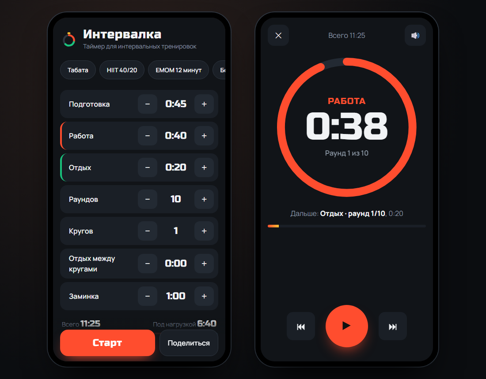

# Интервалка: таймер для табаты, HIIT и бокса

Интервальный таймер, который удобно держать на телефоне во время тренировки: крупные цифры, цвет фазы видно издалека, голос говорит «работа», «отдых» и считает «три, два, один». Устанавливается на главный экран как приложение и работает без интернета.


**Открыть:** [whysafe.github.io/intervalka](https://whysafe.github.io/intervalka/)



## Возможности

**Тренировки**
- Готовые схемы: табата 20/10 × 8, HIIT 40/20, EMOM на 12 минут, 6 боксёрских раундов по 3 минуты, круговая на 3 круга.
- Свои настройки: подготовка, работа, отдых, раунды, круги, отдых между кругами и заминка. Кнопки «+» и «−» можно держать, значения листаются с ускорением.
- Полоса таймлайна показывает всю тренировку цветами, рядом общее время и время под нагрузкой.
- Тренировки сохраняются под своим названием. Любую можно отправить ссылкой: настройки зашиты в адрес (`#10-20-10-8-1-0-0`).

**Во время тренировки**
- Кольцо и кнопка окрашены в цвет фазы: подготовка жёлтая, работа красная, отдых зелёный, заминка синяя.
- Голосовой отсчёт на русском через Web Speech API и сигналы через Web Audio, разные для работы и отдыха.
- Вибрация на телефоне при смене фазы.
- Экран не гаснет: Wake Lock API, блокировка восстанавливается, если свернуть и вернуться.
- Пауза, следующий и предыдущий отрезок. «Назад» в первые две секунды отрезка переходит на предыдущий, позже — в начало текущего, как в плеере.
- Клавиатура на компьютере: пробел — пауза, стрелки — перемотка, Esc — выход.

**Приложение**
- PWA: манифест, иконки (включая maskable для Android) и service worker. После первого открытия всё работает офлайн.
- Настройки и выбранные опции звука запоминаются.

## Запуск

Сборка не нужна. Service worker и ES-модули работают только через сервер:

```bash
python -m http.server 8000     # затем http://localhost:8000
```

## Как устроено

```
js/timeline.js   тренировка как список отрезков, позиция по времени, отсчёт, кодирование ссылки
js/app.js        интерфейс, цикл таймера, звук, голос, вибрация, Wake Lock, сохранение
sw.js            кэш оболочки приложения, stale-while-revalidate
```

- **Время не накапливается тиками.** Таймер помнит момент старта и на каждом шаге вычисляет, какой отрезок идёт сейчас (`positionAt`, бинарный поиск по началам отрезков). Поэтому он не уплывает за долгую тренировку, а пауза и перемотка просто сдвигают точку старта.
- Цикл работает на `setInterval`, а не на `requestAnimationFrame`: rAF останавливается в фоновой вкладке, и сигналы о смене фазы перестали бы приходить.
- Отдых после последнего раунда круга не ставится: вместо него отдых между кругами, а после последнего круга сразу заминка.
- Первый звук проигрывается прямо по нажатию «Старт»: так браузеры, включая Safari на iPhone, разрешают звук на всю тренировку.

## Тесты

```bash
npm test
```

10 тестов: структура табаты и круговой тренировки, непрерывность отрезков, пропуск пустых отрезков, ограничение значений, поиск позиции по времени на границах, отсчёт 3-2-1, формат времени и кодирование ссылки туда и обратно. Тесты запускаются в GitHub Actions на каждый push.

## Автор

whysafe · [whysafe.ru](https://whysafe.ru) · Telegram [@yawhysafe](https://t.me/yawhysafe) · канал [@whysafe_official](https://t.me/whysafe_official) · [Kwork](https://kwork.ru/user/whysafe) · hello@whysafe.ru

## Лицензия

MIT
